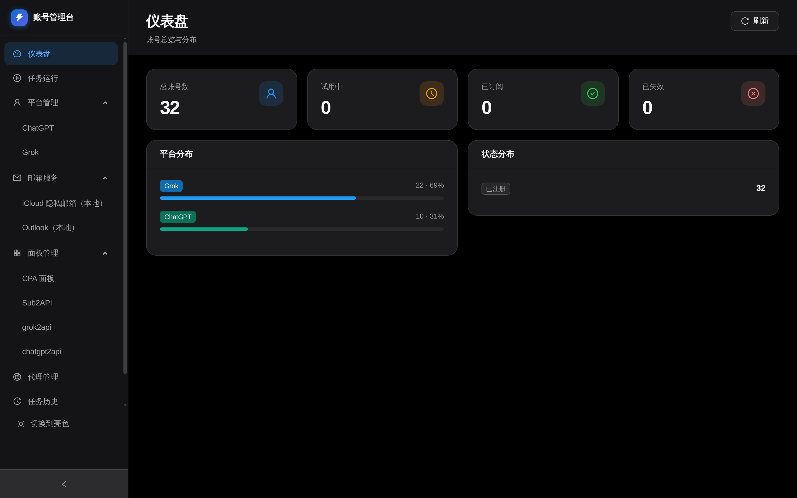
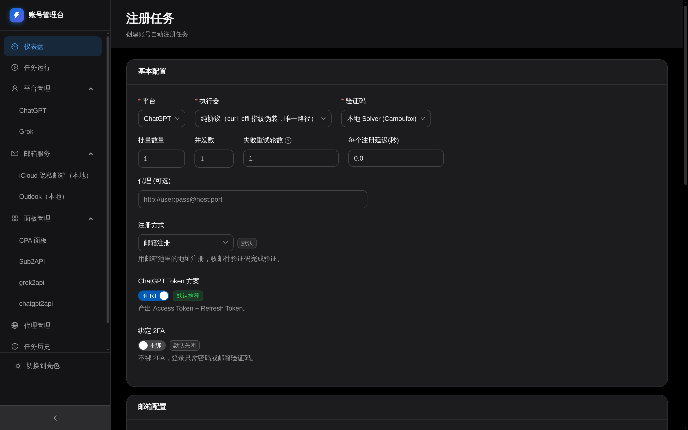
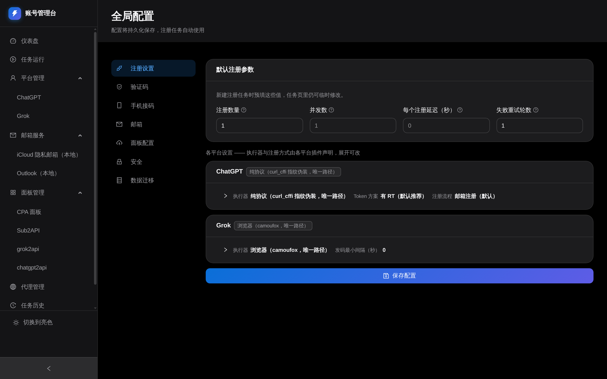

# 账号管理台

多平台账号自动注册与管理系统：插件化平台层、Web 管理台、邮箱号池、面板对比上传、
数据一键迁移，并随后端自动拉起本地 Turnstile Solver。

| 维度 | 支持 |
| --- | --- |
| **平台** | ChatGPT（纯协议，无需浏览器）· Grok（camoufox 浏览器路径） |
| **邮箱来源** | iCloud 隐私邮箱（本地 / 远程仓库）· Outlook / Hotmail（本地号池） |
| **面板对接** | CPA（CLIProxyAPI）· Sub2API · grok2api · chatgpt2api |
| **验证码** | 本地 Turnstile Solver（Camoufox）· YesCaptcha · 手动 |
| **手机接码** | SmsBower · HeroSMS（ChatGPT 命中 add-phone 时无人值守） |
| **凭据加密** | AES-256-GCM，password / AT / RT / IDT / ST / SSO / 2FA / cookies 落盘即密文 |

> ⚠️ 本项目仅供学习与研究，不得用于商业用途。使用产生的一切后果由使用者自负。

---

## 快速开始

### Docker Compose（推荐）

```bash
git clone https://github.com/IFuZYI/auto-register.git Register && cd Register
cp .env.example .env          # 可选：改端口 / 数据目录 / 内存上限 / 镜像源
docker compose up -d --build
```

| 端点 | 说明 |
| --- | --- |
| <http://localhost:8000> | 管理台（启动后先到「全局配置 → 安全」**设登录密码**） |
| `127.0.0.1:8889` | Turnstile Solver，**无鉴权**，compose 默认只绑本机 |

运行数据全在宿主机 `./data`（库 / 密钥 / 日志）—— 备份与迁移就是拷这一个目录。

> ⚠️ `docker compose restart` / `up -d --build` 会**中断正在跑的注册任务**。操作前先在
> 「任务运行」页确认没有进行中的任务。

### 裸机部署

```bash
python3 -m venv .venv && . .venv/bin/activate
pip install -r requirements.txt
python -m playwright install chromium && python -m camoufox fetch   # 浏览器
cd frontend && npm install && npm run build && cd ..                # 前端 → ./static
HOST=127.0.0.1 PORT=8000 python main.py
```

> 不带 `HOST` 会退回 `0.0.0.0`（对外监听），本机自用请显式写 `127.0.0.1`。
> 升级过 camoufox 包之后**必须重跑** `python -m camoufox fetch`（每个包版本钉死浏览器 build）。

开发模式（前端热更新）：后端 `python main.py`，另开终端 `cd frontend && npm run dev`，
访问 <http://localhost:5173>（Vite 已把 `/api` 代理到 8000）。

---

## 部署硬约束：必须单进程

**不要**加 `deploy.replicas` / `scale`，也不要让两个进程共用同一份 SQLite 数据目录。

iCloud 取号的互斥是**进程内** `threading.RLock`；两个进程各持各的锁，谁也挡不住谁，
结果是**领到同一个隐私邮箱**，两边注册都失败，而日志里看不出原因。
要扩进程，先把取号换成跨进程原语。详见 [MAINTENANCE §1.6](docs/MAINTENANCE.md)。

---

## 安全模型

| 面 | 现状 |
| --- | --- |
| 凭据落盘 | 全部 `v1:` 密文；`scripts/encrypt_existing_credentials.py --verify` 可复核 |
| 列表接口 | 只回 `has_password` / `has_token` 等布尔，**不回明文** |
| 详情接口 | 回明文（面板要显示），带 `Cache-Control: no-store` |
| 面板密码 | **未设密码时拒绝一切非本机请求**（503），不是放行 |
| Solver `:8889` | 无鉴权 —— 靠绑定地址，不靠认证；对外必须自行加反代与鉴权 |
| `/docs` `/openapi.json` | 默认关闭（否则未认证者可拿完整路由表） |
| 面板 TLS | 默认**校验**（自签面板请配 CA，别关校验） |

密码用 PBKDF2-HMAC-SHA256（600k 轮 + 每密码独立盐）；鉴权走 `Authorization` 头，
无 Cookie，因此**没有 CSRF 面**。

**密钥文件**（`CREDENTIAL_ENCRYPTION_KEY_FILE`，默认 `data/secrets/credential_key`）
丢失 = 库里凭据全部不可恢复。备份时必须与库一起拷；缺失时启动会打 WARNING。
备份 ZIP 含密钥文件本身，等同于明文凭据库 —— 请当密码对待。

---

## 使用流程

1. **设密码**（对外暴露前必做）
2. **配邮箱**：iCloud 主号生成隐私邮箱，或导入 Outlook 号池。
   ⚠️ 粘贴只是存进号池（「未入池」）—— 要在预览表里勾选并点「导入邮箱池」后才可被领取
3. **配代理**（可选）：账号会保留注册代理，复用时优先走同一出口
4. **注册**：「平台管理 → 注册」弹窗，填数量 / 并发 / 延迟 / 重试轮数，实时日志可停止 / 跳过
5. **维护**：刷新 Token、补 RT、绑 2FA、探测状态、检测 Plus 试用（都是可停止的后台任务）
6. **上传面板**：面板页「本地 ↔ 远程对比」看差异后推送 / 拉回（方向严格分开，绝不拿旧凭证覆盖新的）
7. **迁移**：「全局配置 → 数据迁移」打包库 + 密钥，另一台导入即完成

---

## 项目结构

```text
main.py                 FastAPI 入口（面板 + 静态资源 + 调度器 + Solver 拉起）
api/                    路由层：config / accounts / tasks / actions / backup / auth / integrations
core/                   注册表、凭据加密、配置 schema、调度器、DB 层、代理与执行器
platforms/              平台插件：chatgpt（纯协议）· grok（camoufox）· icloud 邮箱客户端
services/               业务层：注册编排、邮箱号池、面板同步、自动维护、导入导出
modules/                可复用模块：邮箱渠道工厂、配置上下文
frontend/               React + TypeScript + Vite 管理台（构建产物进 static/）
tests/                  pytest 全量套件
scripts/                camoufox 安装、Turnstile 铸造、凭据加密迁移等
docker/                 容器 entrypoint（xvfb + tini）
docs/                   设计与运维文档
```

技术栈：FastAPI + SQLite（SQLModel）/ React + TypeScript + Vite / curl_cffi /
Playwright + Camoufox / ChatGPT Sentinel PoW 走 Node 沙箱。

---

## 测试与质量门禁

```bash
.venv/bin/python -m pytest -q tests/       # 3500+ 条，约 5 分钟
cd frontend && npx tsc -b && npx eslint .  # 类型 + 风格
```

`pytest.ini` 已设 `testpaths = tests` —— 裸跑 `pytest` 与 `pytest tests/` 收集一致。
（不设它会把 `.worktrees/`、`reference/` 下的同名测试一起收进来，报几百个
`import file mismatch`，看起来像项目坏了。）

---

## 常见问题

| 现象 | 原因与处理 |
| --- | --- |
| 注册报「邮箱域名配额用尽」 | 同一邮箱域名一个窗口约 3–4 个，几小时后恢复。**换域名，不是换出口** |
| Grok 发码成功但收不到码 | 确认邮箱渠道真收到信；验证码框可能在**子 frame**（代码已遍历 `page.frames`） |
| ChatGPT 收不到验证码 | 确认 `node` 可执行（Sentinel PoW 要跑 OpenAI 的 `sdk.js`，缺 Node 时 token 过不了复核，邮件**被静默丢弃**） |
| 提示「凭据无法解密」 | `credential_key` 被换或丢了 —— 检查 `DATA_DIR` 挂载、从备份恢复。**不要**重新生成 |
| Solver 显示「未运行」 | 浏览器池空闲 `SOLVER_IDLE_TTL`（默认 300s）会整池回收，`GET :8889/` 仍通；下个请求自动重建（约 30s）。要常驻设 `SOLVER_IDLE_TTL=0` |
| 端口被占用 | `ss -tlnp \| grep :8000` 找到进程停掉再启 |

---

## 文档索引

| 文档 | 回答的问题 |
| --- | --- |
| [FEATURES](docs/FEATURES.md) | 平台能力、邮箱服务、面板对接、导出格式 |
| [DEPLOYMENT](docs/DEPLOYMENT.md) | 部署方式、环境变量、数据目录与一键迁移 |
| [MAINTENANCE](docs/MAINTENANCE.md) | 故障速查、定时任务、**部署约束 §1.6** |
| [API_REFERENCE](docs/API_REFERENCE.md) | 每个接口的请求 / 响应形状 |
| [EXTENDING](docs/EXTENDING.md) | 新增平台 / 注册流程 / 邮箱渠道 |
| [DATABASE_MODULARITY](docs/DATABASE_MODULARITY.md) | 分库、邮箱唯一键、跨库查询 |
| [DATA_DIRECTORY](docs/DATA_DIRECTORY.md) | 数据目录布局与路径规则 |
| [GLOSSARY](docs/GLOSSARY.md) · [ADR](docs/adr/) | 术语表 · 架构决策记录 |

## 界面预览

| 仪表盘 | 注册任务 | 全局配置 |
| --- | --- | --- |
|  |  |  |

---

当前版本：**v0.1.0**（首个公开版本）
